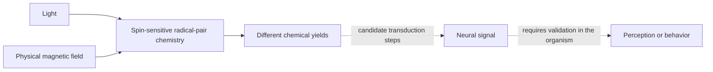

# Cryptochrome, magnetoreception, and the psychic interpretation

[Home](../README.md) · [Magnetism and interfaces](magnetic.md) · [Awareness](awareness.md) · [Research horizon](research-horizon.md) · [Provenance follow-up](../sources/turn3file2-followup.md) · [Source checks](../research/updates/2026-10-30-cryptochrome-magnetoreception-psi.md)

Updated October 30, 2026. **There is a scientific basis for magnetically sensitive protein chemistry and animal magnetic navigation. A useful natural human magnetic sense remains unsettled. The studies reviewed do not establish a cryptochrome mechanism for telepathy or precognition.** Those claims require different evidence.

The recovered **Magnetoreception Applications Research** report is a strong match to the recalled protein-magnetism subject. A newly recovered **Deep Research Availability** answer discusses telepathy but contains no cryptochrome research. Neither identifies the missing turn3file2 source or recovers the recalled side chat. The [provenance follow-up](../sources/turn3file2-followup.md) preserves those distinctions.

## The scientific mechanism

Cryptochromes are a protein family with differing functions. Mammalian type-II CRY1/2 participate in circadian regulation; avian CRY4a is a candidate magnetic receptor. Sharing the family name does not make their cofactor binding, photochemistry, or physiological roles interchangeable.

In the radical-pair proposal, light excites a flavin cofactor. Electron transfer creates radicals whose spin dynamics affect chemical-product yields; a magnetic field can influence those dynamics. A compass must preserve directional information and convert the chemical difference into a usable biological signal. This nonequilibrium chemistry does not require the field to rotate a whole protein against thermal motion like a miniature bar magnet. [M01](../research/updates/2026-10-30-cryptochrome-magnetoreception-psi.md#m01), [M06](../research/updates/2026-10-30-cryptochrome-magnetoreception-psi.md#m06)

The diagram describes the proposed chain. Establishing its chemical steps does not establish the whole chain in a human.

Xu and colleagues measured magnetic sensitivity of robin CRY4 in vitro, with mutations probing electron transfer. Newer work addresses missing steps: ordered attachment of CRY4a to lipid membranes, interaction with a cone G-protein subunit, and light-induced conformational changes. October 2026 ultrafast spectroscopy further resolves early redox dynamics. These strengthen molecular understanding without demonstrating paranormal information transfer. [M01](../research/updates/2026-10-30-cryptochrome-magnetoreception-psi.md#m01), [M15](../research/updates/2026-10-30-cryptochrome-magnetoreception-psi.md#m15), [M16](../research/updates/2026-10-30-cryptochrome-magnetoreception-psi.md#m16), [M19](../research/updates/2026-10-30-cryptochrome-magnetoreception-psi.md#m19), [M31](../research/updates/2026-10-30-cryptochrome-magnetoreception-psi.md#m31)

The strongest counterpoint to “humans have cryptochrome, therefore humans have a magnetic compass” is biochemical specificity. Human type-II cryptochromes bind FAD weakly in the studied preparations. Robin CRY4b and CRY1 also differ from CRY4a in ways that undermine a blanket receptor claim. These findings narrow hypotheses; they do not exclude every possible human magnetic mechanism. [M06](../research/updates/2026-10-30-cryptochrome-magnetoreception-psi.md#m06), [M17](../research/updates/2026-10-30-cryptochrome-magnetoreception-psi.md#m17), [M18](../research/updates/2026-10-30-cryptochrome-magnetoreception-psi.md#m18)

## Replication and competing mechanisms

| Evidence | What was measured | Limit |
|---|---|---|
| Human CRY2 expressed in flies | Light-dependent rescue of magnetic-choice behavior | A human protein in a fly is not a human demonstration |
| Large negative fly study | No magnetic behavior in tested maze/geotaxis conditions | Does not refute all bird or molecular magnetic effects |
| Reppert’s published defense | Objections about conditioning controls and batch-level statistics | Reanalysis/argument, not a new independent positive replication |
| Noncanonical fly work | Responses with a CRY fragment or elevated free FAD | Challenges a uniquely canonical CRY explanation; some cellular fields were much stronger than geomagnetic fields |
| Bird radiofrequency studies | Changes in orientation under particular perturbations | Behavioral disruption need not uniquely identify its molecular cause |

Foley’s human-CRY2 assay used a 0.1–5 G gradient, equivalent to 10–500 µT, and explicitly left human downstream function unknown. Bassetto tested 97,658 maze flies and 10,960 geotaxis flies without finding the proposed behavior. Reppert challenges the controls at the actual test site and the statistical treatment. Animal totals are not counts of independent experiments. [M02](../research/updates/2026-10-30-cryptochrome-magnetoreception-psi.md#m02), [M03](../research/updates/2026-10-30-cryptochrome-magnetoreception-psi.md#m03), [M04](../research/updates/2026-10-30-cryptochrome-magnetoreception-psi.md#m04), [M05](../research/updates/2026-10-30-cryptochrome-magnetoreception-psi.md#m05)

A 75–85 MHz bird perturbation study supports a flavin-radical interpretation. A 2026 modulation study instead reports a contrast its authors interpret against the tested decoherence account; their proposed separate receptor remains hypothetical. Hore’s 2026 magnetite-plus-radical-pair proposal offers a theoretical bridge, with a modeled sensitivity gain rather than an observed human enhancement. [M20](../research/updates/2026-10-30-cryptochrome-magnetoreception-psi.md#m20), [M21](../research/updates/2026-10-30-cryptochrome-magnetoreception-psi.md#m21), [M32](../research/updates/2026-10-30-cryptochrome-magnetoreception-psi.md#m32)

A 2026 pigeon study identifies superparamagnetic liver macrophages and reports impaired overcast orientation after depletion. The proposed magnetic role needs replication and specificity tests because removing immune cells can affect several physiological processes. It does not establish the same mechanism in people. [M22](../research/updates/2026-10-30-cryptochrome-magnetoreception-psi.md#m22)

## Human findings do not yet form one demonstrated pathway

The 2019 EEG experiment found alpha-band changes after particular rotations near 35 µT in 36 volunteers, with eyes closed in darkness. **Its authors used polarity sensitivity to argue against the standard radical-pair-only explanation for that response.** Joining this result to the fly CRY2 paper does not establish consecutive steps of one human cryptochrome pathway. It also did not demonstrate conscious compass use or message reception. [M07](../research/updates/2026-10-30-cryptochrome-magnetoreception-psi.md#m07)

A separate program reports blue-light- and food-context-dependent human directional choices and later Go-stone decision effects. These are positive claims worth independent replication. The Go task involves human choices and ordinary sensory access, rather than independently generated random future targets. Its stated blinding is narrower than full condition blinding: task experimenters knew conditions, although not the intended interpretations. [M08](../research/updates/2026-10-30-cryptochrome-magnetoreception-psi.md#m08), [M09](../research/updates/2026-10-30-cryptochrome-magnetoreception-psi.md#m09)

A 2026 EEG paper combines archival lag correlations with a 22-person exposure follow-up. The follow-up lacks a contemporaneous sham group, and its reported direction differs from the archival pattern. It is not an independent replication of the 2019 rotation protocol. Correlations across past and future dates do not themselves demonstrate precognition. [M10](../research/updates/2026-10-30-cryptochrome-magnetoreception-psi.md#m10)

## Several meanings of protein magnetism

| Route | Scientific status here | Boundary |
|---|---|---|
| Cryptochrome radical-pair chemistry | Supported molecular effects; candidate sensory mechanism | Requires cofactors, geometry, transduction, and organism-level validation |
| MagR/IscA1 protein compass | Contested assembly/alignment proposal | Physical criticism and failed MagR-alone calcium-response tests accompany the claim |
| Magnetite sensing | Separate mineral-based mechanism family | Does not follow merely from having iron-containing proteins |
| MagLOV | Engineered fluorescent protein sensing in living bacterial cells | Requires the probe and optical readout |
| Instrumented interfaces | EEG/computers/TMS or engineered receivers | Hardware supplies the channel |

Meister’s force/heating critique targets particular MagR and ferritin proposals. It cannot be extended to rule out radical-pair chemistry, mineral sensors, TMS, or engineered receivers as a class. Pang’s negative cellular study likewise tests a specific MagR-alone activation claim. [M11](../research/updates/2026-10-30-cryptochrome-magnetoreception-psi.md#m11), [M12](../research/updates/2026-10-30-cryptochrome-magnetoreception-psi.md#m12), [M13](../research/updates/2026-10-30-cryptochrome-magnetoreception-psi.md#m13)

MagLOV is an interesting advance: optically detected magnetic resonance in living bacterial cells, including single-cell readout. One example switches between 0 and 10 mT; 10 mT is 200 times a 50 µT geomagnetic reference. That comparison describes the example, not a universal detection threshold. Protein quantum sensing does not imply biological mind reading. [M14](../research/updates/2026-10-30-cryptochrome-magnetoreception-psi.md#m14)

## Telepathy and precognition

Three interpretations should remain separate:

1. **Unnoticed physical sensing.** If independently confirmed, a human magnetic sense could supply environmental information without an obvious conscious sensation. Calling it “psychic” colloquially would not establish telepathy.
2. **Instrumented thought communication.** BrainNet used EEG, internet transmission, and TMS in five three-person groups, with reported mean task accuracy of 81.25%. Hardware and task structure supply the channel. [M23](../research/updates/2026-10-30-cryptochrome-magnetoreception-psi.md#m23)
3. **Unaided telepathy or paranormal precognition.** A field-sensitive receiver does not establish a sender that encodes thoughts, a decoder that recovers their content, or access to independent future events. None of the protein studies reviewed demonstrates those steps.

Positive psi findings deserve accurate representation. Bem’s original experiments reported positive time-reversed effects; a later 90-experiment meta-analysis reported a small positive aggregate. A registered Ganzfeld meta-analysis also reports a positive effect and favorable bias tests. These are published statistical claims. They did not measure cryptochrome or demonstrate a magnetic channel. Registering a retrospective synthesis does not prospectively register every historical experiment it includes. [M24](../research/updates/2026-10-30-cryptochrome-magnetoreception-psi.md#m24), [M25](../research/updates/2026-10-30-cryptochrome-magnetoreception-psi.md#m25), [M28](../research/updates/2026-10-30-cryptochrome-magnetoreception-psi.md#m28)

Contrary evidence also matters. The large AMP–TPP project did not reproduce Bem’s predicted positive direction. A reversed anomaly was confirmed once, then failed in the next larger study: Study 3 was 50.07%, with a standard error of 0.11 percentage points, across 217,800 trials. A separate backward-priming study found no significant behavioral effect; an fMRI psi test found no distinguishing neural response; an older 30-study Ganzfeld synthesis was nonsignificant. These are different tests with different limits, not a universal proof of impossibility. [M26](../research/updates/2026-10-30-cryptochrome-magnetoreception-psi.md#m26), [M27](../research/updates/2026-10-30-cryptochrome-magnetoreception-psi.md#m27), [M29](../research/updates/2026-10-30-cryptochrome-magnetoreception-psi.md#m29), [M30](../research/updates/2026-10-30-cryptochrome-magnetoreception-psi.md#m30)

The strongest objection to categorical dismissal is the persistence of some positive meta-analytic estimates. The strongest objection to treating them as an established ability is the absence of a stable, prospectively reproduced effect with a demonstrated information pathway. Molecular quantum chemistry does not fill that gap.

Circadian anticipation of day–night cycles is biological timekeeping. Predicting events from present environmental cues is inference. Neither is evidence of receiving information from a future independent random event.

## Relation to hypnosis and sleep influence

Cryptochrome’s circadian role does not demonstrate magnetic insertion of suggestions during sleep. Hypnosis and sleep conditioning can change particular measured experiences or responses; neither supplies a missing sender, receptor, or semantic code. The bounded combined PubMed query found an adjacent circadian/sleep-fragmentation review rather than a direct cryptochrome–telepathy, hypnosis, or sleep-conditioning demonstration. That is a search limit, not proof every possible combination has been tested.

Use the [hypnosis](hypnosis.md), [sleep](sleep.md), and [posthypnotic/pink-noise review](posthypnotic-sleep-and-pink-noise.md) for demonstrated influence endpoints. A future combination must establish its physical sensory channel separately, then compare actual perception, memory, or behavioral outcomes.

## Milestones that would move the boundary

| Claim | Evidence needed |
|---|---|
| Cryptochrome sensory mechanism | Receptor-specific causal intervention/rescue, field and illumination controls, downstream signaling in the intact organism |
| Useful natural human magnetic sense | Independent blinded replication, artifact controls, held-out behavioral discrimination, error rates and awareness measures |
| Natural magnetic communication | Sender and receiver demonstrated; fresh content-dependent targets with ordinary leakage and common cues excluded |
| Precognition | Prospectively fixed scoring, independent future targets, transparent timing/randomization, independent replication |
| Added hypnosis/sleep effect | Demonstrated sensory pathway, component comparisons, persistence and transfer |

No experiment was conducted. The [32-entry source record](../research/updates/2026-10-30-cryptochrome-magnetoreception-psi.md) distinguishes molecular results, behavior, theory, original syntheses, replication attempts, and inspection limits.
