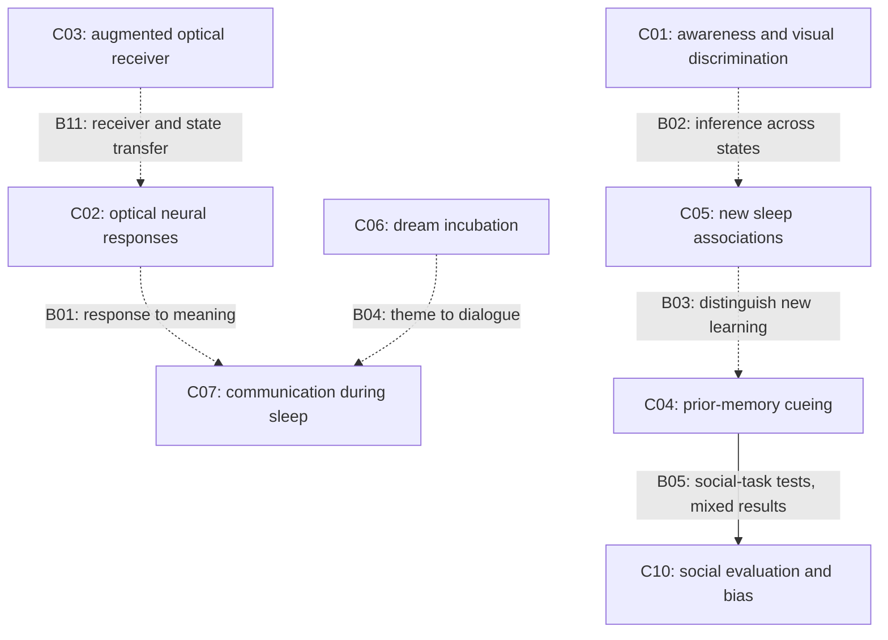
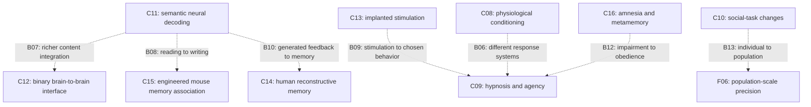

# Research network: the science–science-fiction horizon

[Home](../README.md) · [Combined-technique review](combined-techniques.md) · [Evidence ledger](evidence-ledger.md) · [Source checks](../research/updates/2026-10-28-horizon-source-checks.md)

The [research focus](../README.md#research-focus) is hypnosis, sleep influence, and mind control. Start with C04–C09 and the behavioral-control question in F05. Use the broader network to test a specified influence pathway; memory reconstruction and AI misinformation are supporting branches.

The [posthypnotic/sleep/pink-noise follow-up](posthypnotic-sleep-and-pink-noise.md) directly develops that focus: lasting behavior, renewed cue responsiveness, sleep-conditioned transfer, opposing cue effects, and acoustic replication limits. The capability, bridge, and scenario IDs remain stable.

The [replication and modality follow-up](decoded-feedback-and-ai-memory.md) traces C17/B08 and B10 evidence by cohort, adds direct conventional-feedback combinations, and preserves the missing decoded-fMRI and AI-distortion interactions. The capability and bridge IDs remain stable.

The [reconsolidation/source-monitoring follow-up](reconsolidation-and-source-monitoring.md) examines possible mechanisms around C04/C09/C14 and B10/B14. It distinguishes changed content from changed access or source judgment, includes supportive and failed replications, and preserves the missing direct AI–sleep–hypnosis combination. No new capability is inferred solely from joining those literatures.

The [prediction-error/RES follow-up](prediction-error-and-suggestibility.md) tests that inference more closely: mismatch types, context, new learning, protective testing, sensory limits, and correction status. The existing capability/bridge/scenario IDs stay unchanged.

The [context/detection follow-up](context-reinstatement-and-detection.md) examines accuracy and contamination under different kinds of reinstatement, detection versus remembered change, and limits on sleep/hypnosis transfer. Its warning-paper dataset check prevents counting a later encoding analysis as an independent replication.

**Real results exist on both sides of the brain–environment interface: changing some responses, learning some associations, decoding some information, and delivering some stimulation. The frontier lies in the missing connections between these capabilities.** A result about one response, species, state, or device does not establish the whole system suggested by a science-fiction scenario.

This is a curated network of the collection, assessed October 28, 2026. It adds targeted source checks for connections across fields; it is not an exhaustive review or a forecast of when a technology will arrive. Primary papers control their reported results. The connections and horizon judgments below are editorial inferences, open to revision.

## Read the network

The map has three layers:

- **Capabilities, C01–C17:** measured endpoints and the conditions under which they were reported. “Demonstrated” here describes a bounded result, not universal reliability or independent replication of every paper.
- **Connections, B01–B14:** the relationship between capabilities, including actual integrations, competing interpretations, and missing bridges. A connection is not automatically a causal mechanism.
- **Horizons, F01–F06:** larger capabilities with explicit prerequisites. A speculative endpoint can contain established components without becoming established itself.

Evidence strength, awareness, invasiveness, and generalization are separate dimensions. A highly reproducible neural response can still provide little evidence of comprehension. An effect in an engineered mouse can be well established within that preparation while offering little direct evidence for an ordinary human capability.

The [combination follow-up](combined-techniques.md) adds 16 selected publications, positive and null combination studies, human decoded-feedback learning, and a distinction between integration, added benefit, and synergy. It updates B04, B08, and B10, adds C17 and B14, and leaves the larger speculative endpoints open. The diagrams below remain selected schematics; the register includes the added connections.

## How the research connects

These are schematic relationship maps. **Solid arrows describe the bounded relationships stated on the arrows; dotted arrows describe proposed extensions.** Labels name bridge entries below. Neither arrow style measures effect size or a probability of success. The tables remain readable without the diagrams.

BrainNet already integrates an EEG decision decoder with TMS-delivered cues. The dotted B07 arrow concerns the **further** combination with rich semantic decoding, not the existence of all brain-to-brain communication. Similarly, some optical communication during lucid dreaming has been reported; B01 asks about generalization beyond that trained, experienced setting.

## Capability register

Source labels S01–S24 link to the [source-check record](../research/updates/2026-10-28-horizon-source-checks.md), which distinguishes primary studies, synthesis, methodological argument, and access limits. Sample sizes below describe the cited study, not an entire field.

### C01 — Visual discrimination and awareness

**Measured:** the multisite working-memory study found above-chance orientation responses after a delay on trials rated unseen. It analyzed 531 complete participants across 19 laboratories. **Interpretation remains conditional:** a subjective zero-visibility report and a defensible inference of unconscious processing are different claims; selection, response criteria, and sensitivity matter. The methods critique is relevant to that inference, not an independent replication of the same experiment. [S01–S02](../research/updates/2026-10-28-horizon-source-checks.md#s01)

Connects to **B02** and [awareness](awareness.md). It provides neither a general measure of absent experience nor a demonstration of complex instructions understood without awareness.

### C02 — Optical stimulation and neural responses

**Measured:** almost imperceptible spectral flicker can evoke frequency-specific EEG responses while awake; visual stimulation during verified sleep can also evoke such responses. These are separate protocols. The sleep study included 30 healthy adults; it did not test message comprehension. Lower perceived flicker is not a zero-awareness finding. [S03–S04](../research/updates/2026-10-28-horizon-source-checks.md#s03)

Connects to **B01, B11** and [optical signaling](optical.md). A response at the stimulation frequency does not establish that the brain decoded a meaning assigned to that frequency.

### C03 — An added optical receiver changes the available channel

**Measured:** humans wearing upconversion contact lenses discriminated near-infrared information. The material converts the input into light the visual system can use. This is an engineered, aided sensory channel. [S05](../research/updates/2026-10-28-horizon-source-checks.md#s05)

Connects to **B11** and [optical signaling](optical.md). Receiver availability, wake/sleep state, and stimulus awareness require separate evidence. This result does not establish unaided infrared comprehension.

### C04 — Cueing a memory learned before sleep

**Supported across studies:** targeted memory reactivation can improve later memory under some conditions. A 2020 meta-analysis combined 91 experiments, 2,004 participants, and 212 effect sizes; the pooled estimate was Hedges’ g = 0.29, 95% CI [0.21, 0.38]. Stage, task, cueing, and heterogeneity constrain reuse of that estimate. This is a synthesis, not another independent experiment. [S06](../research/updates/2026-10-28-horizon-source-checks.md#s06)

Connects to **B03, B05** and [sleep](sleep.md). Reinforcing previously encoded material is different from supplying an unfamiliar rule, skill, or worldview during sleep.

The [CT1 follow-up](combined-techniques.md#ct1) identifies an actual rescripting–cueing combination, alongside null augmentation studies in other procedures. Clinical and physiological endpoints must remain separate; success in one procedure is not a general rule for combining techniques.

### C05 — Forming restricted new associations during sleep

**Measured:** tone–odor pairings changed later sniff responses, including after waking. A separate auditory word–sound study found later image-choice transfer in 22 analyzed participants. These results concern restricted associations and specified tests. The image-choice endpoint does not turn auditory encoding into optical sleep learning. [S07–S08](../research/updates/2026-10-28-horizon-source-checks.md#s07)

Connects to **B02, B03** and [conditioning](conditioning.md). Novel association, compositional understanding, subjective experience, and later explicit recollection are separate outcomes.

### C06 — Influencing reported dream themes

**Measured:** Dormio used prompts around sleep onset and serial reports to influence dream content. The result concerns incorporation of prompted material during a particular incubation procedure. [S09](../research/updates/2026-10-28-horizon-source-checks.md#s09)

Connects to **B04** and [sleep](sleep.md). Theme incorporation does not establish control of a detailed plot, the dreamer’s decisions, or later behavior. Reporting demands and the sleep-onset/awakening procedure are relevant alternatives and constraints.

### C07 — Exchanging information during some sleep periods

**Measured:** a four-group study reported 29 correct answers in 158 attempts during signal-verified lucid dreams, across six of 36 participants; most attempts produced no response, and routes and tasks differed across groups. A separate lexical-decision study found intermittent trained facial responses during several sleep stages in 49 napping participants, including 27 with narcolepsy. [S10–S11](../research/updates/2026-10-28-horizon-source-checks.md#s10)

Connects to **B01, B04** and [sleep](sleep.md). Sleep is not synonymous with absent experience. Lucid communication can be consciously experienced; forgotten experience and transient responsiveness complicate claims about ordinary unconscious sleep. The four groups are not four replications of an optical protocol.

### C08 — Conditioning a specific physiological response

**Measured:** after prior drug–flavor pairing, a double-blind placebo-controlled human study found conditioned changes in specified immune measures. [S12](../research/updates/2026-10-28-horizon-source-checks.md#s12)

Connects to **B06** and [conditioning](conditioning.md). A learned immune response does not establish drug replacement, arbitrary behavior, or a general susceptibility trait.

The [sleep-conditioning follow-up](posthypnotic-sleep-and-pink-noise.md#sleep-conditioning) distinguishes new associations expressed after waking, the smoking behavior result, a separate alcohol-cue null, and failed counter-bias replication. These endpoints and study relationships qualify transfer to broader behavior.

### C09 — Suggestion can change a task response; agency needs its own measure

**Measured:** a posthypnotic-suggestion study found altered Stroop-related behavior and neural activity in highly hypnotizable participants under specified task conditions. Theoretical accounts of dissociation propose different explanations for hypnotic responding. [S13–S14](../research/updates/2026-10-28-horizon-source-checks.md#s13)

Connects to **B06, B09, B12** and [hypnosis](hypnosis.md). The Stroop study is not itself proof of subjective involuntariness or a particular dissociation theory. Task performance, experienced agency, compliance, and recall require separate measures and comparison conditions.

The [durability follow-up](posthypnotic-sleep-and-pink-noise.md#posthypnotic) adds week-to-eight-week tests, waking-request controls, and modern cued outcomes. Repeated cueing and persistent unprompted action remain separate claims.

Separate pre-sleep suggestion studies increased slow-wave sleep in selected participants. A reanalysis found no memory benefit and reduced slow-wave/spindle coupling. This motivates **B14**; it does not establish a causal mediator or an already-tested failure of hypnosis plus cueing. See [CT2](combined-techniques.md#ct2).

### C10 — Social evaluation and bias are distinct, limited endpoints

**Measured, with important contrary evidence:** a 2025 sleep-cueing study reported changed evaluations of faces associated with cued names. A 2015 counterbias TMR study reported an advantage after prior training; a 2019 direct replication found no cueing benefit immediately or one week later. [S15–S17](../research/updates/2026-10-28-horizon-source-checks.md#s15)

Connects to **B05, B13** and [population influence](population-and-fiction.md). The failure concerns the 2015 counterbias procedure; it is not a direct failed replication of the different 2025 study. Ratings, implicit-bias tasks, and durable behavior outside the laboratory cannot be treated as one endpoint.

### C11 — Decoding semantic information from recordings

**Measured:** a trained fMRI decoder generated language resembling the meaning of perceived or imagined material; cooperation was needed for training and use in the cited study. A separate reconstruction analysis shows how plausible generated details can exceed information established by neural input. [S18–S19](../research/updates/2026-10-28-horizon-source-checks.md#s18)

Connects to **B07, B08, B10** and [memory reconstruction](memory.md). Semantic similarity is not verbatim access to arbitrary thoughts. A convincing image is not independently verified autobiographical recovery.

### C12 — A computer-mediated brain-to-brain channel

**Measured:** BrainNet combined EEG, computers/network transmission, and TMS-induced visual cues in five groups of three people performing a binary collaborative task. Participants used an understood cue-to-decision mapping. This is an actual integration of reading and stimulation. [S20](../research/updates/2026-10-28-horizon-source-checks.md#s20)

Connects to **B07** and [neural interfaces](magnetic.md). The source explicitly identifies binary information complexity and substantial hardware/setup as limitations. It does not demonstrate ordinary unaided telepathy or semantic contents written directly into a recipient’s understanding.

### C13 — Wireless power for an implanted neural stimulator

**Measured:** a miniature magnetoelectric device supported acute motor-cortex stimulation in humans and chronic operation for 30 days in pigs. The receiver and external transmitter are components of the system. [S21](../research/updates/2026-10-28-horizon-source-checks.md#s21)

Connects to **B09** and [magnetic interfaces](magnetic.md). Acute human operation, chronic animal operation, ordinary weak-field sensing, and precise behavioral control are different claims.

### C14 — Human memory can incorporate later misinformation

**Measured:** a human experiment found behavioral misinformation effects and related hippocampal/cortical patterns. The neural associations inform a model of reconstructive memory; they do not make every part of that model a demonstrated causal mechanism. [S22](../research/updates/2026-10-28-horizon-source-checks.md#s22)

Connects to **B10** and [memory](memory.md). Altered answers about studied material do not establish precise replacement of an arbitrary personal history. Repeated confidence or vividness is not independent corroboration.

The [CT4 follow-up](combined-techniques.md#ct4) identifies direct human evidence involving generated feedback. It supports detail-level contamination while leaving integration with brain-derived autobiographical reconstructions untested.

The [mechanism review](reconsolidation-and-source-monitoring.md#ai) separates reconsolidation from new learning, context/source confusion, and reporting effects. Its sleep and hypnosis links concern restricted endpoints; the combined personal-memory scenario remains open. Positive replications and recoverability findings must be evaluated together.

The [retrieval follow-up](prediction-error-and-suggestibility.md#retrieval) adds direct evidence that initial retrieval can help uncontaminated information while changing learning of later misinformation. A retrieved answer, a discrepancy signal, and a durable source error are distinct links.

The [context/detection follow-up](context-reinstatement-and-detection.md#context) adds a further boundary: reinstatement can support correct recognition or convincing false matches. Context-spread during sleep, source influence attributed to AI, and interview-component effects provide restricted connections; the joined personal-memory capability remains unestablished in the selected evidence.

### C15 — An engineered false association in mice

**Measured:** optogenetic manipulation of tagged hippocampal cells produced context-specific fear behavior in mice in a context not paired directly with shock. This is a substantial causal animal result with genetic and optical prerequisites. [S23](../research/updates/2026-10-28-horizon-source-checks.md#s23)

Connects to **B08** and [memory](memory.md). An experimentally constructed context–fear association is different from writing an arbitrary, detailed human episodic memory. Species and intervention requirements are part of the result.

### C16 — Impairing memory and memory monitoring

**Measured:** controlled drug research found changes in episodic memory and aspects of confidence/monitoring. The cited experiment measured memory and metamemory, not programmable cooperation. [S24](../research/updates/2026-10-28-horizon-source-checks.md#s24)

Connects to **B12** and [historical programs and drugs](history-and-drugs.md). Memory impairment, compliance, and a later inability to report an event cannot substitute for one another. Historical program objectives require separate records of what was actually achieved.

### C17 — Representation-linked feedback and learning

**Measured:** human decoded-neurofeedback studies combine neural pattern measurement with reinforcement and report restricted perceptual, confidence, or threat-response changes. These are actual feedback–learning loops. They differ from passive semantic decoding and from direct neural stimulation. [CT3 and sources D09–D13](combined-techniques.md#ct3)

The intended symbolic association failed in one conceptual study despite neural target-pattern learning. A small phobia trial changed a neural endpoint without a significant self-reported fear change. Connects to **B08**, [memory](memory.md), and [interfaces](magnetic.md). Target-pattern success cannot substitute for independent transfer or real-life behavior.

The [new replication trace](decoded-feedback-and-ai-memory.md#replication) identifies identical data behind the two confidence papers. Other modalities add task-dependent findings, including a decoded-fNIRS result without nearby task transfer. Conventional EEG combinations with sleep/hypnosis are adjacent evidence, not direct tests of the same decoded-fMRI capability.

## Connection register: where the inference can break

These are assessments of the cited evidence, not claims that the entire literature has ruled a capability in or out. “Missing” means the larger connection is not established by this network. The proposed discriminating evidence is a research criterion, not a report that a test was run.

| Bridge | Relationship and current assessment | Strongest objection or alternative | Evidence that would advance or weaken the connection |
|---|---|---|---|
| **B01 · C02 → C07** | Neural response to light → semantic sleep communication. Optical communication has a narrow trained lucid-dream example; general transfer remains missing. | Frequency-following need not carry understood content; experienced lucidity, arousal, or prior code training may explain success. | Independent message-level accuracy on new content, state verification, suitable awareness/arousal controls, and replication of the same optical task. Responses confined to arousal or trained items would narrow the claim. |
| **B02 · C01 → C05** | Awake awareness findings → claims of unconscious sleep learning. This is an inference across paradigms, not a demonstrated bridge. | “Unseen,” asleep, unaware of learning, and unable to remember later are different measurements. | Within the learning paradigm, specify which awareness is at issue and compare direct/indirect measures with justified sensitivity. Residual access or criterion shifts would weaken a zero-awareness interpretation. |
| **B03 · C04 ↔ C05** | Prior-memory reactivation and new association formation both involve sleep learning; they require distinct evidence. | Familiar components, reactivation, and later recognition can mimic learning a genuinely new relationship. | Prespecified new relations, appropriate prior-learning controls, held-out transfer, and delayed tests. Benefits confined to old items support consolidation rather than general instruction learning. |
| **B04 · C06 → C07** | Dream incubation plus communication suggests adaptive interaction. A separate waking-rescripting/sleep-cueing combination has positive evidence, but reliable online construction remains open. [CT1](combined-techniques.md#ct1). | Dream-emotion or nightmare benefit is not proof of online scene control; other augmentation procedures have null outcomes. | Independently replicate the exact combined procedure, then test the proposed online endpoint. Distinguish clinical benefit, content reports, and dialogue. |
| **B05 · C04 → C10** | TMR has been applied to social tasks. There are positive reports and a direct failed counterbias replication. | A task score can change without durable social behavior; protocol and endpoint differences matter. | Independent replication of the exact task, delayed behavioral outcomes, comparable awake controls, and retention/attrition reporting. Null behavior despite task-score changes would limit transfer. |
| **B06 · C08 ↔ C09** | Physiological conditioning and hypnotic responding may share contextual or learning factors. A general mechanism joining their endpoints is missing. | Different response systems and expectancy can account for superficial similarity. | Predictive cross-task evidence beyond expectancy, selection, and baseline responsiveness, with distinct physiological, behavioral, and agency measures. No cross-task transfer would oppose a general susceptibility inference. |
| **B07 · C11 → C12** | BrainNet integrates a simple decoder and stimulation. Integration with rich semantic decoding is a further, unestablished capability. | The recipient interprets an agreed binary cue; decoding rich content does not supply a way to write it. | Independently verified novel content transfer beyond the trained codebook, explicit error/bandwidth measures, and signal-shuffling controls. Category-only transfer would leave rich semantics unresolved. |
| **B08 · C11/C17 ↔ C15** | Human decoder-guided reinforcement is an intermediate capability; causal animal manipulation is a different route. Neither establishes arbitrary human semantic writing. [CT3](combined-techniques.md#ct3). | Intended symbolic transfer failed in one study; neural and subjective endpoints dissociated in another. Feedback training is not the inverse of decoding. | Demonstrate the intended new relation, independent transfer, suitable feedback controls, and durability. Neural engagement alone does not close the bridge. |
| **B09 · C13 → C09** | Delivering stimulation → predictable specified behavior or altered agency. The general bridge is missing. | A stimulated neural or motor response is not equivalent to understanding an instruction or changing a goal. | Separate stimulation engagement, specified behavior, agency reports, and appropriate comparison conditions; require reproducibility across settings before broader claims. Physiology without the claimed behavior does not close the bridge. |
| **B10 · C11 ↔ C14** | Generated media and suggestive conversation have direct memory-distortion evidence. Combination with brain-derived personal reconstruction is still untested here. [CT4](combined-techniques.md#ct4). | Detail-level errors are not complete episodic replacement. Misleading content and model priors can explain apparent agreement without neural recovery. | Preserve reports before feedback and compare neural, shuffled-signal, and matched non-neural inputs against independent facts. Test interaction and durability rather than inferring them from separate studies. |
| **B11 · C03 → C02** | An engineered receiver expands accessible optical input. Transfer to another state or an unaided person is missing. | The receiver itself supplies the missing transduction; sleep can change access and response. | Demonstrate the claimed endpoint with the actual receiver and state, with receiver-absent controls. Effects disappearing without the lens support the aided channel only. |
| **B12 · C16 → C09** | Drug-related amnesia or monitoring changes → reliable obedience. The cited evidence does not establish that bridge. | Impairment can disrupt comprehension and action as well as later recall; cooperative laboratory responses do not isolate obedience. | Evidence must measure the specified behavior and alternatives separately from recall or confidence. Impairment without selective behavioral change would count against a programmable-cooperation claim. |
| **B13 · C10 → F06** | Individual social-task changes → population-level precision. This is a separate scaling and causal-attribution problem. | Exposure selection, ordinary persuasion, common events, heterogeneous effects, and dropout can explain aggregate patterns. | Independent exposure evidence, realistic comparisons, behavior outside the original task, durability, and replication across populations. Aggregate drift alone cannot identify a precise mechanism or actor. |
| **B14 · C09 ↔ C04** | Pre-sleep suggestion plus memory cueing is a plausible combination; the reviewed evidence does not establish its added memory benefit. [CT2](combined-techniques.md#ct2). | More slow-wave sleep occurred without better retention; changed coupling may matter, but mediation is unproven. | Direct component comparison, a retained-learning endpoint, and relevant oscillatory measures. A beneficial sleep proxy alone is insufficient. |

## Horizon register

These scenario labels are organizing devices. They are neither predictions nor evidence that a system exists. A scenario can become more plausible while another version remains unsupported; scope must move with the evidence.

| Horizon | Closest demonstrated components | Boundary as of this assessment | Most informative next milestone |
|---|---|---|---|
| **F01 · Learning new material while asleep** | C04 prior-memory cueing; C05 restricted new associations; C07 transient communication. | Restricted forms are already scientific findings. Broad, durable acquisition of unfamiliar compositional knowledge or complex skills is not established by these examples. | Independent delayed transfer to new problems, with prior knowledge, arousal, and awareness separated. **B02–B03**. |
| **F02 · Adaptive dream interaction** | C06 prompted themes; C07 some online dialogue. | Limited interactions are real. Reliable scene construction, detailed scripted experiences, and control of later goals remain speculative extensions. | Replicated online interaction with prespecified content and independently scored reports, plus persistence beyond the session where claimed. **B01, B04**. |
| **F03 · Sharing rich thoughts through machines** | C11 semantic decoding; C12 binary EEG–TMS communication. | Instrumented low-complexity communication is real. Arbitrary semantic transfer, broad person-to-person generalization, and useful everyday bandwidth remain missing here. | New content transferred beyond a learned codebook, with recipient comprehension, end-to-end errors, and hardware requirements reported. **B07**. |
| **F04 · Editing a detailed personal memory** | C14 misinformation/generated feedback; C15 engineered mouse association; C11 decoding; C17 feedback learning. | Restricted changes are measured. Precise replacement of an arbitrary human episode does not follow from combining these findings. | Intended content-specific change checked against independent facts, separating source confusion, confidence, and invented details. **B08, B10** and [CT3–CT4](combined-techniques.md). |
| **F05 · A general-purpose behavior override** | C08 specific conditioning; C09 selected suggestion effects; C13 stimulation; C16 impairment. | These components alter different endpoints under different conditions. A reliable mechanism for arbitrary instructions and enduring goal replacement is not established. | Reproducible specified behavior beyond the original task, with understanding, agency, expectancy, memory, and selection measured separately. **B06, B09, B12**. |
| **F06 · Precise population-scale influence** | C10 narrow social-task effects and the collection’s separate population research agenda. | A laboratory effect cannot establish targeted durable mass behavior. This network does not assess every ordinary media or persuasion mechanism. | Exposure-linked, independently replicated real-world behavioral effects, heterogeneous outcomes, durability, and a causal comparison. **B05, B13**. |

## What to track next

The next work follows the user's [research focus](../README.md#research-focus). These are research questions, not additional demonstrated capabilities:

1. **Hypnosis and posthypnotic behavior:** which suggestions change perception, action, or experienced agency; how long do effects persist; and how do responsiveness, cooperation, resistance, and setting affect the outcome? Start with C09 and [hypnosis](hypnosis.md).
2. **Influence during sleep:** distinguish cueing prior learning, forming new associations, influencing dreams, and changing later waking responses. Which effects survive replication and adequate sleep/awareness measurement? Start with C04–C07, B01–B05, and [sleep](sleep.md).
3. **Hypnosis–sleep–conditioning combinations:** does a direct combination change the intended outcome beyond its components, or introduce interference? Prioritize [CT1–CT2](combined-techniques.md#ct1) and C08–C09.
4. **Control beyond the laboratory task:** do effects generalize to later actions, preferences, habits, or goals, including when the person resists? Keep subjective involuntariness, compliance, impairment, and independently observed behavior separate. Track F05, B06, B12, and [historical records](history-and-drugs.md).

Pursue AI, memory theory, or interface engineering when it answers one of those questions. A new finding in a supporting branch alone does not set the next research priority.

This is a manual watchlist; no recurring monitoring has been activated. To update it, add a dated source-check record, identify the exact capability and bridge affected, state the observed endpoint and conditions, include the strongest contrary result, and explain the resulting scope change. Retain earlier assessments in Git rather than silently replacing uncertainty with a success label. Never count a review, correction, reanalysis, and its underlying experiment as independent replications.

The strongest objection to a categorical boundary is that capabilities can emerge through engineering combinations. The strongest objection to an optimistic combination is that its parts may depend on incompatible receivers, states, tasks, and representations. **The discriminating evidence is a working end-to-end system measured against its claimed outcome.** Absence of that evidence is a current gap, not a proof of impossibility.
